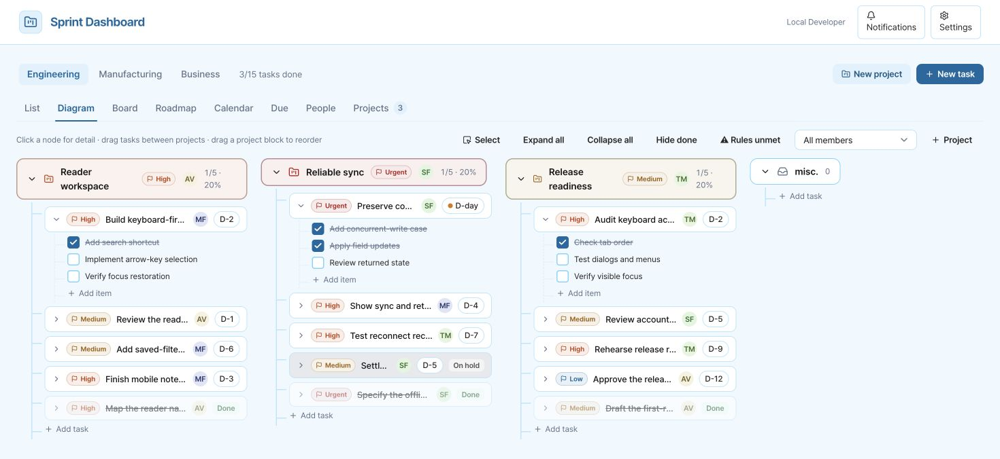

# Sprint Dashboard

[English](README.md) · 한국어

Sprint Dashboard는 프로젝트, 업무, 일일 기록, 마감일을 관리하는 웹서비스입니다. 서로 연결된 8개 보기를 제공하며, 밝은 하늘색 인터페이스와 영어 시스템 레이블을 사용합니다.

[필수 조건](#사전-준비와-사용자-데이터) · [빠른 시작](#로컬-설치) · [사용 흐름](#사용-흐름) · [구조](#구조와-검증) · [기능 목록](docs/FEATURE-PARITY.md)



*가상의 시연 데이터를 넣고 실제 로컬 서비스에서 캡처한 Diagram 화면입니다. 프로젝트 집계는 D1에 저장한 실제 레코드에서 계산하며, 회사 자료나 실제 연락처는 표시하지 않습니다.*

## 사전 준비와 사용자 데이터

초기 데이터베이스는 비어 있습니다. 회사 계정, 직원, 프로젝트 레코드, 자격 증명은 포함하지 않습니다. README 스크린샷의 가상 데이터는 로컬 보조 스크립트를 명시적으로 실행할 때만 생성하며, 설치나 배포 과정에서는 넣지 않습니다.

| 필수 조건 | 필요한 기능 | 설정 방법 |
|---|---|---|
| Node.js 22.13 이상과 npm | 로컬 개발 및 빌드 | 지원되는 Node 런타임 설치 |
| 운영 환경 인증 | 로그인 및 사용자별 데이터 분리 | 자체 배포에서는 Cloudflare Access, Sites에서는 Sites 인증 사용 |
| D1 바인딩 `DB` | 모든 업무, 프로젝트, 댓글, 구성원, 기록, 설정 | `.openai/hosting.json`에 선언되어 있으며, 로컬에서 마이그레이션 적용 |
| R2 바인딩 `BUCKET` | 첨부 파일 및 메모에 삽입한 이미지 | `.openai/hosting.json`에 선언되어 있으며, Sites 배포 시 호스팅 스토리지 제공 |
| `INTEGRATION_OWNER_ID`, `GOOGLE_ACCESS_TOKEN`, `GOOGLE_DRIVE_ROOT_ID` | Google Drive 폴더 탐색, 생성, 이동 | Drive 접근 권한이 있는 본인의 OAuth 액세스 토큰과 루트 폴더 ID 설정 |
| `INTEGRATION_OWNER_ID`, `OPENAI_API_KEY`, `OPENAI_MODEL` | AI 작업 지시 및 프로젝트 배정 | 본인의 API 계정과 명시적으로 선택한 호환 모델 설정 |
| `INTEGRATION_OWNER_ID`, `RESEND_API_KEY`, `MAIL_FROM` | 담당자 배정 및 멘션 이메일 실제 발송 | 본인의 Resend 계정과 인증된 발신 도메인 설정 |

기본 계획 관리, 8개 보기, 댓글, 반응, 일일 기록, 구성원 관리, 체크리스트·메모 편집, 실행 취소는 외부 API 키 없이 사용할 수 있습니다. 첨부 파일에는 R2가 필요합니다. Drive, AI, 이메일 기능은 각각의 자격 증명을 설정하기 전까지 사용할 수 없으며, 오류 메시지에 누락된 설정을 안내합니다. 연동 결과가 성공한 것처럼 꾸며 표시하지 않습니다.

비밀 값은 배포 서버의 환경 변수에만 설정하세요. 로컬 개발에서는 Git에서 제외되는 `.dev.vars` 파일을 만들고 본인의 자격 증명만 넣으세요. 이 파일은 절대 커밋하지 마세요. `INTEGRATION_OWNER_ID`는 **Settings → External connections**에 표시되는 로그인 사용자의 ID와 같아야 합니다. 서버에 설정한 연동 자격 증명은 해당 소유자만 사용할 수 있습니다. 다른 사용자는 독립적인 기본 작업 공간을 사용할 수 있지만, 소유자의 외부 연동은 사용할 수 없습니다. Google 액세스 토큰에는 유효기간이 있으므로 현재 버전에서는 만료된 토큰을 직접 교체해야 합니다. OAuth 토큰 갱신·동의 화면은 아직 제공하지 않습니다.

| 사용자 데이터 | 필수 필드 / 형식 |
|---|---|
| 프로젝트 | 이름 필수. 설명, 소유자, 팀, 중요도, 목표일은 선택 |
| 업무 | 제목 필수. 담당자, 프로젝트, 상태, 중요도, 시작일·마감일은 선택. 날짜 형식은 `YYYY-MM-DD` |
| 구성원 명부 | 이름, 이메일 필수. 팀, 직함은 선택. 로그인 초대나 공유 계정이 아닌 연락처 명부 |
| 일일 기록 | 업무/프로젝트, 유효한 날짜, 비어 있지 않은 본문 |
| 첨부 파일 | 최대 20 MB. 이미지는 화면 안에 표시하며, 다른 형식은 다운로드 |
| Grant Project에서 전달받기(이전 이름: Grants) | `/import/grant?payload=`에 base64url로 인코딩한 UTF-8 JSON 전달. `title`, `grantId` 필수. `description`, `dueDate`, `priority`(`urgent/high/medium/low`), `sourceUrl`(HTTP/S)은 선택 |

CSV/XLSX 가져오기 API는 제공하지 않습니다. Grant Project에서 전달받은 내용은 인증된 검토 화면에서 확인하며, 사용자가 확정한 뒤에만 업무를 생성합니다. 같은 지원사업 ID를 다시 전달하면 해당 사용자의 기존 업무를 반환합니다.

## 로컬 설치

```sh
git clone https://github.com/dpwld/sprint-dashboard.git
cd sprint-dashboard
npm ci
npm run setup
npm run dev -- --port 4314
```

로컬 설치에는 ChatGPT 계정이나 유료 API 키가 필요하지 않습니다. `npm run setup`은 서비스를 빌드하고 커밋된 로컬 마이그레이션을 적용하며, 예시 데이터를 넣지 않습니다. [설치 안내](docs/INSTALLATION.md), [본인 Cloudflare 계정에 배포](docs/SELF-HOSTING.md), [기여 방법](CONTRIBUTING.md)을 참고하세요.

터미널에 출력된 루프백 주소를 열고 개발용 로그인 절차를 진행하세요. Sites 스타터의 모의 로그인은 로컬에서만 작동합니다. `npm start -- --port 4314`는 빌드된 Worker와 로컬 D1/R2를 실행하지만, 이 명령 자체는 모의 로그인을 제공하지 않습니다. 두 실행 방식 모두 `.wrangler/state`에 로컬 데이터를 저장합니다. 호스팅된 D1은 별도의 데이터베이스이며, Sites는 배포 시 커밋된 마이그레이션을 적용합니다.

`db/schema.ts`를 변경한 뒤에는 `npm run db:generate`를 실행하고, 생성된 마이그레이션을 검토한 다음 `npm run db:migrate`로 적용하세요. 일반적인 설치에는 이미 커밋된 마이그레이션을 사용합니다.

데이터가 채워진 예시 화면을 재현하려면 포트 4314에서 로컬 미리보기를 실행한 상태로 다음 명령을 사용하세요.

```sh
node scripts/screenshot-fixture.mjs seed
# Engineering → Diagram 또는 Board를 캡처한 뒤, 생성한 레코드만 삭제:
node scripts/screenshot-fixture.mjs cleanup
```

이 스크립트는 `http://127.0.0.1:4314`만 사용하고 리디렉션을 거부하며, 실제 인증된 API와 D1을 통해 데이터를 생성합니다. 가상 프로젝트 3개, 4가지 중요도를 모두 포함한 업무 15개, 명부 구성원 4명, 일일 기록 6개, 댓글 3개를 만듭니다. 이름은 모두 가상이며, 이메일은 예시용으로 예약된 `.example` 도메인을 사용합니다. 생성된 ID는 Git에서 제외되는 `.wrangler/screenshot-fixture.json`에 기록합니다. 정리 작업은 이 목록에 있는 레코드만 삭제하고 관련 없는 데이터는 보존합니다. 이메일, AI 등 외부 연동은 호출하지 않습니다. 정리가 끝날 때까지 매니페스트 파일을 보관하세요.

## 사용 흐름

- 모든 보기와 상세 패널에서 중요도 색상의 의미가 같습니다. 빨간색 **Urgent**(긴급), 주황색 **High**(높음), 호박색 **Medium**(보통), 파란색 **Low**(낮음)를 사용합니다. 색상과 함께 텍스트 레이블을 표시하며, 완료 상태는 초록색으로 표시합니다.
- 시스템 UI는 영어입니다. 사용자가 작성한 내용은 원래 언어를 유지합니다. 이전 `pm.lang` 설정은 화면 언어를 바꾸거나 자동 번역을 실행하지 않습니다. 기존 번역 캐시 레코드와 API 규약은 호환성을 위해 유지합니다.
- List, Diagram, Board, Roadmap, Calendar, Due, People, Projects 사이를 이동할 수 있습니다. Engineering, Manufacturing, Business는 별도 팀 구분으로 유지합니다.
- 프로젝트를 만든 뒤 담당자, 중요도, 날짜를 지정한 업무를 추가하세요. 업무 상세 패널에서 목표, 중간 점검일, 완료 기준, 체크리스트, 메모를 편집할 수 있습니다.
- 업무를 프로젝트 그룹이나 보드 열 사이로 드래그할 수 있습니다. 프로젝트 집계는 실제 업무 상태에서 계산합니다. 보관한 프로젝트는 현재 작업용 보기에서 제외합니다.
- 댓글, 멘션, 반응, 날짜별 진행 기록을 추가하세요. 파일을 첨부하거나 연결된 Drive 폴더를 사용할 수 있습니다.
- 체크리스트가 있는 업무를 하위 업무가 포함된 프로젝트로 전환할 수 있습니다. 현재 세션에서 지원되는 업무·프로젝트 변경은 Ctrl/Cmd+Z로 실행 취소할 수 있습니다.
- Settings에서 본인의 구성원 명부를 추가하고, 외부 연결의 필수 설정과 연동 실행 결과를 확인하세요.

## 구조와 검증

기존 React Sprint 컴포넌트와 도메인 규약은 `components/pm`에 유지하며, 공통 UI 의존성은 `components/ds`에 있습니다. `lib/data`에는 HTTP 어댑터가 있습니다. Vinext API 라우트는 인증된 요청을 검증하고, `lib/server/store.ts`를 통해 소유자별로 분리된 D1 레코드의 필드를 원자적으로 갱신합니다. R2 파일은 반환하기 전에 소유자 메타데이터를 확인합니다. 서식이 있는 HTML은 서버에서 안전하게 정제하며, 메모의 텍스트 서식 기능은 텍스트를 HTML로 해석하지 않고 DOM 노드를 생성합니다. 업무 데이터는 브라우저의 localStorage에 저장하지 않으며, 기존 화면 표시 설정만 localStorage를 사용합니다.

데이터는 계정 단위로 분리합니다. 구성원 명부에 등록되거나 기존 비공개 프로젝트의 공개 범위 필드가 설정되어도 다른 ChatGPT 계정에 접근 권한이 생기지 않습니다. 계정 간 협업, 접속 상태 표시, Supabase 실시간 동기화는 현재 버전에 포함되지 않습니다. 인증된 요청으로 15초마다 폴링하여 같은 계정의 작업 공간을 새로고침합니다.

실제 로컬 D1·도메인 테스트와 격리된 DOM 회귀 테스트는 `npm test`로 실행합니다. `npm run typecheck`와 `npm run build`도 실행하세요. 로컬 서버를 실행한 상태에서 `node tests/http-smoke.mjs`를 실행하면 인증된 HTTP·R2 사용 흐름을 검증하고, 테스트가 만든 레코드를 정리합니다.

수행한 검증과 알려진 제한 사항은 [구현 보고서](docs/IMPLEMENTATION-REPORT.md)를 참고하세요. 외부 연동을 실제로 사용하기 전에는 사용자 소유 자격 증명으로 검증해야 합니다. QA에서는 유료 AI를 호출하거나, 이메일을 발송하거나, 회사 Drive 데이터에 접근하지 않습니다.

README 구성은 [Plane](https://github.com/makeplane/plane), [Twenty](https://github.com/twentyhq/twenty), [Actual](https://github.com/actualbudget/actual), [Immich](https://github.com/immich-app/immich)가 공개 문서에서 사용하는 소개 방식을 참고했습니다. 타사 배지나 스크린샷으로 검증 또는 보증을 암시하지 않습니다.
