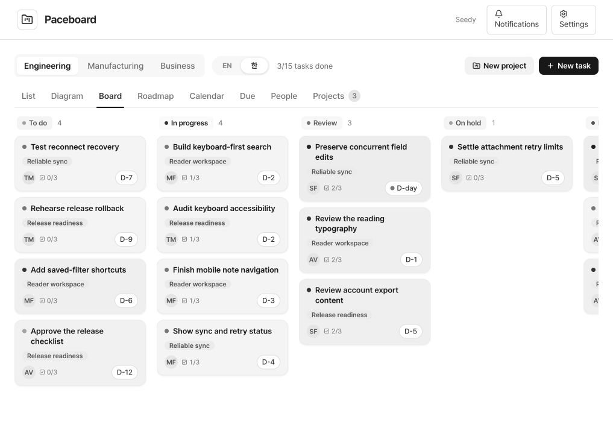

# Paceboard

Paceboard is a private web service for projects, tasks, daily logs and deadlines, with eight connected views and a monochrome interface.

[Requirements](#prerequisites-and-your-data) · [Quickstart](#local-setup) · [Workflows](#workflows) · [Architecture](#architecture-and-verification) · [Feature inventory](docs/FEATURE-PARITY.md)



*Actual local service with fictional demonstration data for the example screenshots. Project rollups come from saved D1 records; no company records or real contacts are shown.*

## Prerequisites and your data

The runtime database starts empty. No company accounts, employees, project records or credentials are included. The README screenshot dataset is fictional and is created only by an explicitly run local helper; installation and deployment never seed it.

| Requirement | Required for | Setup |
|---|---|---|
| Node.js 22.13+ and npm | Local development and build | Install a supported Node runtime |
| Sites ChatGPT authentication | Hosted sign-in and per-user data isolation | Keep the prepared private Site’s identity; hosting supplies authenticated identity |
| D1 binding `DB` | All tasks, projects, comments, members, logs and settings | Already declared in `.openai/hosting.json`; apply migrations locally |
| R2 binding `BUCKET` | Attachments and embedded memo images | Declared in `.openai/hosting.json`; Sites provisions hosted storage |
| `INTEGRATION_OWNER_ID`, `GOOGLE_ACCESS_TOKEN`, `GOOGLE_DRIVE_ROOT_ID` | Google Drive folder browsing, creation and moves | Your own OAuth access token with Drive access and your own root folder ID |
| `INTEGRATION_OWNER_ID`, `OPENAI_API_KEY`, `OPENAI_MODEL` | Korean/English translation, AI work orders and project assignment | Your own API account and explicitly selected compatible model |
| `INTEGRATION_OWNER_ID`, `RESEND_API_KEY`, `MAIL_FROM` | Actual assignment and mention email delivery | Your own Resend account and verified sender domain |

Core planning, all eight views, comments, reactions, daily logs, members, checklist/memo editing and undo work without external API keys. Attachments require R2. Drive, translation, AI and email remain unavailable until their own credentials are configured; errors name the missing setup. No integrations fabricate a successful result.

Configure secrets only in deployment server environment variables. For local development create an ignored `.dev.vars` with only your own credentials. Never commit it. `INTEGRATION_OWNER_ID` must equal the signed-in user ID displayed under **Settings → External connections**. Server integration credentials are restricted to that owner. Other users retain independent core workspaces but cannot use that owner’s integrations. Google access tokens expire; this release requires replacing the token and does not yet provide an OAuth refresh/consent UI.

| Your data | Required fields / format |
|---|---|
| Project | Name; optional description, owner, team, priority, target date |
| Task | Title; optional owner, project, status, priority, start/due dates; calendar dates use `YYYY-MM-DD` |
| Member directory | Full name, email; optional team and job title. This is a directory, not an invitation or shared login |
| Daily log | Task/project, valid calendar date, nonempty text |
| Attachments | Files up to 20 MB. Images display inline; other formats download |
| Grantory handoff (formerly Grants) | `/import/grant?payload=` base64url UTF-8 JSON: `title`, `grantId`; optional `description`, `dueDate`, `priority` (`urgent/high/medium/low`), `sourceUrl` (HTTP/S) |

There is no CSV/XLSX import endpoint. The Grantory handoff is an authenticated review screen and creates a task only after confirmation. Repeating the same grant ID returns the existing task for that user.

## Local setup

```sh
npm ci
npm run build
npm run db:migrate
npm run dev -- --port 4314
```

Use the printed loopback URL and the development sign-in flow. The Sites starter’s mock sign-in is local only. `npm start -- --port 4314` runs the built Worker with local D1/R2 but does not itself simulate sign-in. Both modes persist local storage under `.wrangler/state`. Hosted D1 is a separate database; Sites applies committed migrations at deployment.

After changing `db/schema.ts`, run `npm run db:generate`, review the generated migration and apply it with `npm run db:migrate`. Normal setup uses the committed migrations.

To reproduce the populated example screens, keep the local preview running on port 4314 and run:

```sh
node scripts/screenshot-fixture.mjs seed
# Capture Engineering → Diagram or Board, then remove only the created records:
node scripts/screenshot-fixture.mjs cleanup
```

The helper is fixed to `http://127.0.0.1:4314`, rejects redirects and uses the actual authenticated API/D1. It creates three fictional projects, 15 tasks, four directory members, six daily logs and three comments. Names are invented and emails use reserved `.example` domains. The created IDs are recorded in ignored `.wrangler/screenshot-fixture.json`; cleanup uses only that list and preserves unrelated records. It never calls email, AI or other external integrations. Keep the manifest until cleanup is complete.

## Workflows

- Move among List, Diagram, Board, Roadmap, Calendar, Due, People and Projects. Engineering, Manufacturing and Business remain separate team partitions.
- Create a project, then add tasks with an assignee, priority and dates. Edit objective, checkpoint, completion criteria, checklist and memo in the task drawer.
- Drag tasks between project groups or board columns. Project rollups derive from actual task status. Archived projects leave the active working views.
- Add comments, mentions, reactions and dated progress logs. Attach files or use a configured Drive folder.
- Convert a checklist task into a project with child tasks. Use Ctrl/Cmd+Z for the current session’s supported task/project changes.
- Add your own directory members under Settings, inspect connection prerequisites and review integration run results.

## Architecture and verification

Original React Sprint components and domain contracts are retained under `components/pm`, with shared UI dependencies under `components/ds`. `lib/data` contains HTTP adapters. Vinext API routes validate authenticated requests and apply atomic field updates to owner-scoped D1 rows through `lib/server/store.ts`. R2 reads verify owner metadata before returning files. Rich HTML is sanitized on the server, and memo text formatting constructs DOM nodes without parsing text as HTML. No browser business records are stored in localStorage; only original presentation preferences use it.

The account is the data boundary. Directory membership and the original private-project visibility fields do not grant another ChatGPT account access. Cross-account collaboration, presence indicators and Supabase realtime are not part of this release; authenticated 15-second polling refreshes the same account’s workspace.

Run `npm test` for real local D1/domain and isolated DOM regression tests, `npm run typecheck`, and `npm run build`. With the local server running, `node tests/http-smoke.mjs` checks the authenticated HTTP and R2 workflows and cleans up its own records.

See [implementation report](docs/IMPLEMENTATION-REPORT.md) for executed checks and known limitations. External integrations must be validated with user-owned credentials before relying on them; QA does not call paid AI, send mail or access company Drive data.

README structure follows the publicly documented presentation patterns of [Plane](https://github.com/makeplane/plane), [Twenty](https://github.com/twentyhq/twenty), [Actual](https://github.com/actualbudget/actual), and [Immich](https://github.com/immich-app/immich). No third-party badges or screenshots imply verification or endorsement.
